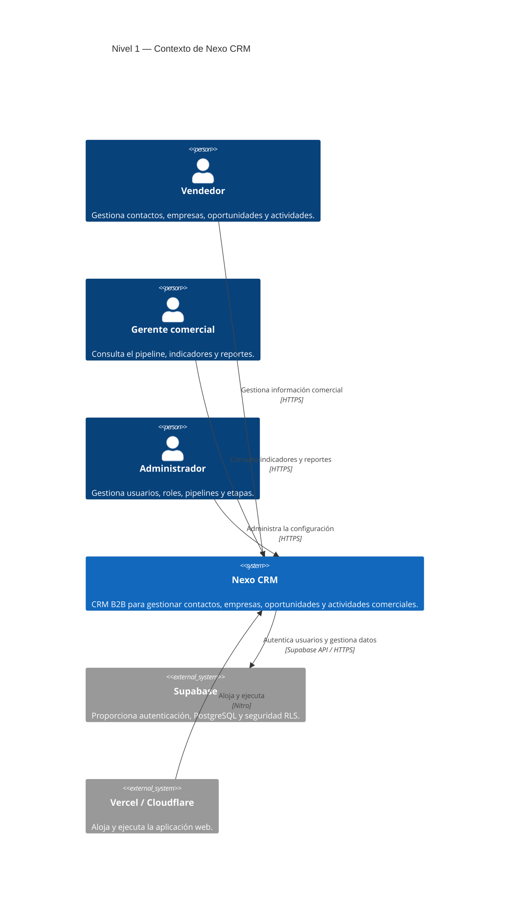
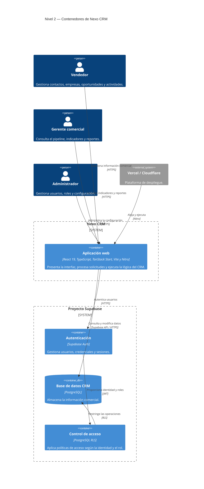
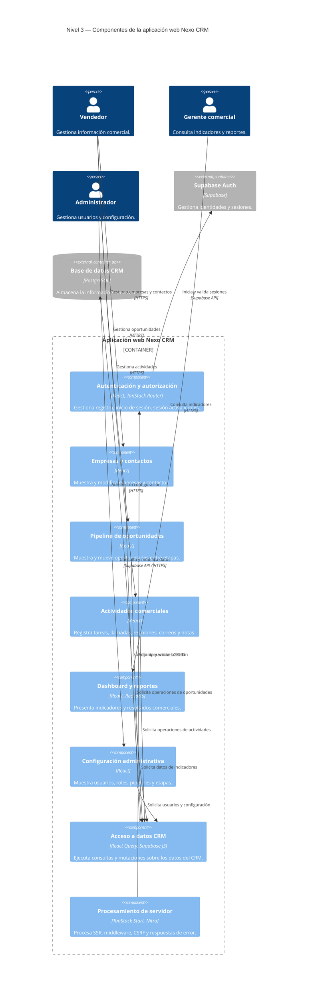
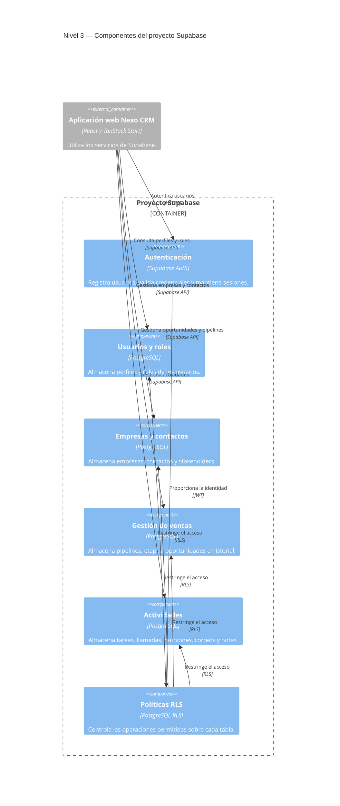

# Arquitectura C4 de Nexo CRM

> Versión local histórica incorporada a Git el 22/10/2026. Estos diagramas
> preceden la separación interna de persistencia del módulo 6. El estado y los
> límites actuales se documentan en [dossier 07](../dossier/07-distribucion-y-resiliencia.md).

## Nivel 1 — Contexto

## Nivel 2 — Contenedores

## Nivel 3 — Componentes de la aplicación web

### Archivos de los componentes de la aplicación web

- **Autenticación y autorización:** `src/routes/login.tsx`, `src/routes/signup.tsx`, `src/hooks/use-auth.ts` y `src/routes/_authenticated/route.tsx`.
- **Empresas y contactos:** `src/routes/_authenticated/companies.tsx`, `src/routes/_authenticated/contacts.tsx` y `src/components/crm/`.
- **Pipeline:** `src/routes/_authenticated/pipeline.tsx` y `src/components/crm/deal-dialog.tsx`.
- **Actividades:** `src/routes/_authenticated/activities.tsx` y `src/components/crm/activity-dialog.tsx`.
- **Dashboard y reportes:** `src/routes/_authenticated/dashboard.tsx` y `src/routes/_authenticated/reports.tsx`.
- **Configuración:** `src/routes/_authenticated/settings.tsx`.
- **Acceso a datos:** `src/lib/crm.ts` y `src/integrations/supabase/client.ts`.
- **Procesamiento de servidor:** `src/server.ts`, `src/start.ts` y `src/integrations/supabase/auth-middleware.ts`.

## Nivel 3 — Componentes de Supabase

### Archivos de los componentes de Supabase

- **Autenticación:** `supabase/config.toml`.
- **Usuarios, roles y datos del CRM:** `supabase/migrations/20260805035001_05269e6f-a1a0-41ee-9053-ba7d49685ade.sql`.
- **Stakeholders y documentos:** `supabase/migrations/20260822010000_add_stakeholders_and_client_health.sql`.
- **Políticas RLS:** instrucciones `CREATE POLICY` de los archivos en `supabase/migrations/`.
