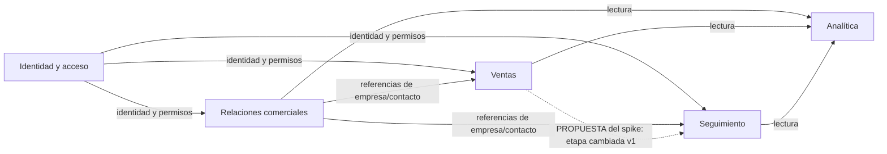

# 06 — Dominio, límites e integración (Módulo 5)

Fecha: 16/10/2026. Base de código inspeccionada: `72622d1`.
**Estado:** análisis trazado al código y propuesta de límites para revisión en PR.
Los contextos siguientes son una interpretación explícita del dominio, no módulos
ya extraídos ni decisiones históricas aprobadas por los tres integrantes.

## 1. Dominio y lenguaje

Nexo CRM organiza la relación comercial B2B: una **empresa** tiene **contactos**;
una **oportunidad** representa una venta posible, recorre **etapas** de un **pipeline**
y tiene un propietario. Una **actividad** registra seguimiento, tarea, llamada,
reunión, email o nota; su responsable puede diferir de quien la creó. Un **rol**
de autorización (`vendedor`, `gerente`, `admin`) no equivale a un stakeholder comercial.
Un registro `type=email` representa una actividad; no demuestra envío de correo.

El núcleo comercial propuesto es **Ventas**. **Relaciones comerciales** y
**Seguimiento** lo soportan. **Identidad y acceso** es capacidad genérica apoyada
en Supabase; **Analítica** construye vistas de consulta. No hay evidencia de que el
CRM venda productos, cobre pagos, gestione inventario o necesite esos contextos.

## 2. Mapa de contextos propuesto y evidencias actuales

| Contexto               | Responsabilidad, modelo y reglas observables                                                                                                             | Dueño funcional propuesto (rol, sin asignar personas) | Evidencia as-is                                                                                                                                                                                 |
| ---------------------- | -------------------------------------------------------------------------------------------------------------------------------------------------------- | ----------------------------------------------------- | ----------------------------------------------------------------------------------------------------------------------------------------------------------------------------------------------- |
| Identidad y acceso     | Usuario, perfil, rol y pertenencia al equipo; sesión y políticas de acceso.                                                                              | Administración del CRM                                | `src/hooks/use-auth.ts`, `src/integrations/supabase/`, funciones SQL `can_access_owner`, `has_role`, `team_member_ids`                                                                          |
| Relaciones comerciales | Empresas y contactos; propietarios, ciclo de vida y borrado lógico. Stakeholders/documentos existen en esquema, sin afirmar una UI completa.             | Gestión comercial de cuentas                          | `useCompanies`, `useContacts`, `useSaveCompany`, `useSaveContact` en `src/lib/crm.ts`; rutas `companies.tsx`, `contacts.tsx`; migración `20260822010000_add_stakeholders_and_client_health.sql` |
| Ventas (núcleo)        | Oportunidad, pipeline, etapa e historial. El cambio de etapa ajusta probabilidad/estado y deja historial en PostgreSQL.                                  | Gerencia comercial                                    | `useDeals`, `useMoveDeal`, `useStages`, `usePipelines`; `src/routes/_authenticated/pipeline.tsx`; triggers `apply_deal_stage_defaults`, `handle_deal_stage_change`                              |
| Seguimiento            | Actividades, autor, asignado y referencias opcionales a empresa/contacto/oportunidad. `activities_insert` restringe creación/asignación según identidad. | Equipo comercial que ejecuta el seguimiento           | `useActivities`, `useSaveActivity`, `useToggleActivity`; `src/routes/_authenticated/activities.tsx`; tabla/políticas `activities`                                                               |
| Analítica (lectura)    | Indicadores y reportes derivados. No posee la verdad de empresas, oportunidades o actividades.                                                           | Gerencia comercial                                    | `src/routes/_authenticated/dashboard.tsx`, `reports.tsx`; vista SQL `company_value_summary`                                                                                                     |

Los símbolos SQL de la tabla están en
`supabase/migrations/20260805035001_05269e6f-a1a0-41ee-9053-ba7d49685ade.sql`,
salvo la extensión de stakeholders/documentos y `company_value_summary` de la segunda migración citada.

Las flechas continuas agrupan relaciones observables; la punteada identifica una
integración **propuesta y experimental**. En el sistema actual, mover una oportunidad
no genera por sí mismo una actividad de seguimiento.

## 3. Límites actuales frente a límites objetivo

Hoy los hooks de cinco capacidades comparten `src/lib/crm.ts` y el cliente Supabase.
Hay joins de lectura entre oportunidades, empresas y contactos, y claves foráneas
entre dominios. **No se afirma un monolito modular con persistencia aislada.**

| Contexto    | Contrato propuesto hacia otros contextos                       | Dependencia permitida objetivo                          | Dependencia que se quiere evitar                                 |
| ----------- | -------------------------------------------------------------- | ------------------------------------------------------- | ---------------------------------------------------------------- |
| Identidad   | Identificador de usuario y autorización verificada             | Servicio Auth y esquema de perfiles/roles               | Importar reglas comerciales para autenticar                      |
| Relaciones  | Referencias y proyecciones públicas de empresa/contacto        | Identidad; almacenamiento propio                        | Modificar etapas u oportunidades por acceso directo              |
| Ventas      | Comando de cambio de etapa; evento experimental v1             | Identidad y referencias/proyecciones de Relaciones      | Escribir tablas de Seguimiento desde la UI de ventas             |
| Seguimiento | Crear/consultar actividad; consumidor idempotente experimental | Identidad, referencias comerciales y contrato de evento | Conocer componentes React o modificar reglas de estado de Ventas |
| Analítica   | Proyecciones de lectura                                        | Lectura de las otras capacidades bajo permisos          | Cambiar el estado del negocio desde un reporte                   |

El mapa objetivo no se implementa con una refactorización completa en este PR.
El spike prueba un corte entre Ventas y Seguimiento; conserva la aplicación existente.

### Criterios de límites y métricas honestas

- Cohesión: Ventas cambia por reglas de oportunidad; Seguimiento, por agenda/asignación.
  Es un argumento de responsabilidad, no un porcentaje medido de cohesión.
- Acoplamiento actual: joins y FK `deals → companies/contacts` y
  `activities → deals/companies/contacts`, además del cliente compartido; localizables
  en `crm.ts` y las migraciones. Un contrato de evento reduce conocimiento temporal,
  pero mantiene dependencia de su esquema y exige compatibilidad.
- Volatilidad y esfuerzo de cambio: **no medidos**. Se verificarían comparando los
  archivos afectados por cambios concretos y sus PR; no se inventan cifras Ca/Co.
- La autonomía es lógica propuesta. No implica despliegue o base de datos separados.
- Riesgo conocido: un único archivo de hooks concentra responsabilidades de varias
  entidades. Su tamaño no demuestra por sí solo un fallo o cuello de botella.

## 4. Flujo elegido y contratos versionados

Flujo actual: vendedor → `pipeline.tsx` → `useMoveDeal` → Supabase/PostgREST →
`deals_update` → triggers de etapa e historial → invalidación React Query `deals`.

Capacidad experimental: después de ese cambio, generar **una tarea** de seguimiento.
El efecto usa la tabla real `activities`; no simula un correo enviado ni inventa un
servicio de notificaciones desplegado.

| Contrato del spike                                                                     | Productor/consumidor                            | Semántica                                                                                                                |
| -------------------------------------------------------------------------------------- | ----------------------------------------------- | ------------------------------------------------------------------------------------------------------------------------ |
| [`m5-mover-oportunidad.v1.schema.json`](contratos/m5-mover-oportunidad.v1.schema.json) | Harness autenticado → RPC `m5_spike_move` local | UUID de oportunidad, etapa destino, modalidad e ID idempotente. Etapa del mismo pipeline y propietario igual al usuario. |
| [`m5-etapa-cambiada.v1.schema.json`](contratos/m5-etapa-cambiada.v1.schema.json)       | RPC → outbox → consumidor local                 | Evento `crm.deal.stage_changed.v1`, versión 1, etapa anterior/nueva, propietario y fechas asignados en DB.               |

Cambios incompatibles deben publicar una versión nueva y un lector compatible o una
migración explícita. No se reutiliza un ID para otro comando. El ID del evento es
tanto correlación como ID de la actividad; una entrega repetida no la duplica.

**Síncrono:** el llamador espera la actividad; si falla el receptor puede recibir un
error aunque la etapa ya haya cambiado. **Asíncrono:** la aceptación confirma el
cambio y un evento durable, no que la actividad ya exista. La UI productiva necesitaría
mostrar estado pendiente y distinguirlo de una tarea terminada.

Los contratos corresponden al fixture del experimento. El cliente de producción
sigue usando los hooks y tipos actuales; este PR no publica una API productiva nueva.

## 5. Seguridad y consistencia del corte

- Cambio de etapa y registro del evento en una transacción PostgreSQL local.
- Funciones `SECURITY INVOKER`: se ejecutan con el JWT del vendedor y con RLS.
- Entrega y actividad se confirman en otra transacción; no hay garantía de entrega
  única de mensajes. Se ensaya **efecto idempotente** con entregas repetidas.
- El vendedor ajeno no debe ver, mover ni materializar eventos del propietario.
- Una etapa de otro pipeline debe rechazarse antes de producir efectos.
- La fixture da permisos de escritura sobre su tabla al propietario para simplificar
  el laboratorio; no está lista para producción ni sustituye una revisión de permisos.
- Un consumidor productivo necesitaría autenticación de servicio, monitoreo, backoff,
  manejo de eventos venenosos, retención y concurrencia. No se dan por implementados.

## 6. Spike, decisión y cierre del módulo

Plan previo: [`PLAN.md`](experimentos/spike-01-integracion/PLAN.md), commit `e348616`.
Implementación y reproducción: [Spike 1](experimentos/spike-01-integracion/README.md).
Decisión propuesta: [ADR-005 de integración](adrs/ADR-005-integracion-oportunidades-actividades.md).

La [corrida válida y su interpretación](experimentos/spike-01-integracion/resultados/RESUMEN.md)
quedaron registradas con su SHA y URL de CI. Hubo 48 muestras y cinco verificaciones
funcionales exitosas; el primer intento fallido también se conserva. La aceptación
asíncrona fue menor, pero la finalización tardó más en este entorno controlado.
La revisión humana de límites y decisión corresponde al PR; no se registra una
aprobación ficticia de equipo o mini-comité.
