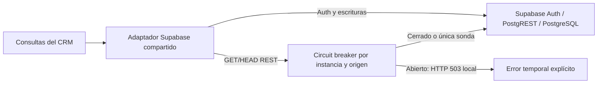

# 07 — Distribución y resiliencia: módulo 6

Actualización 22/10/2026: se corrigieron los dos errores de tipos del formulario
de acceso con campos vinculados a `FieldPath<T>`, sin conversiones a `never`.
`npm run typecheck` se incorpora a Docker y al CI. Los registros del 16/17 de
octubre conservan lo observado entonces; no se reescriben sus resultados.
Los materiales locales históricos se publican con índice en
[`entregables/README.md`](../entregables/README.md).

Fecha inicial: 16/10/2026; ampliado el 17/10/2026, Colombia. **Avance técnico implementado y medido**; el veredicto
del mini-comité 2 requiere una sesión real del equipo y está pendiente.

El material nuevo se registra en [trazabilidad ampliada](../docs/modulo-6-material-actualizado.md). Se incorporan [crecimiento k6](../experimentos/crecimiento-S11/README.md), [matrices separadas](../docs/resilience_matrix.md), propiedad de persistencia y [guion de defensa](../docs/defensa-modulo-6.md).

## 1. Qué pide AVATA y qué se entrega

Se revisaron visualmente las tres láminas del módulo 6: experimento/táctica
(semana 11), ecosistema metropolitano y decisión/mini-comité 2 (semana 12).
Sus cifras de e-commerce y sus tecnologías son ejemplos, no requisitos de NEXUS.

| Requisito de las imágenes                     | Evidencia de este avance                                                                                                                   |
| --------------------------------------------- | ------------------------------------------------------------------------------------------------------------------------------------------ |
| Escenario y umbrales antes del resultado      | [PLAN de EXP-004](experimentos/EXP-004-resiliencia/PLAN.md), commit `5998eff`                                                              |
| Táctica implementada y comparación con base   | Adaptador compartido de Supabase con circuit breaker; EXP-004 pareado                                                                      |
| p95/p99, throughput, errores y recursos       | [Resultados originales](experimentos/EXP-004-resiliencia/resultados/docker-local-2026-10-16/README.md), 1.440 muestras y `docker stats`    |
| Matriz de fallos/resiliencia                  | Sección 5; controles implementados separados de propuestas                                                                                 |
| Alternativas de distribución, costos y riesgo | Secciones 6–7; TCO paramétrico con supuestos explícitos                                                                                    |
| Fitness function en CI                        | `fitness.mjs`, pruebas negativas y workflow `docker-local.yml`                                                                             |
| ADR 4 con evidencia y veredicto               | [ADR-006 de distribución/resiliencia](adrs/ADR-006-distribucion-y-resiliencia.md): veredicto técnico **ajustada**, comité pendiente   |
| Uso crítico de IA y preparación de defensa    | [Log EDAV](LOG-EDAV-auditoria-ia.md) y sección 9                                                                                           |
| PR/participación por integrante               | No se atribuyen aportes a otros integrantes. El usuario indicó subir a rama, sin abrir PR; la revisión académica por pares queda pendiente |

## 2. Arquitectura y problema reales

NEXUS conserva una aplicación React/TanStack Start/Nitro y usa Supabase para Auth,
PostgREST y PostgreSQL. Es una unidad de aplicación con una dependencia de red;
no todo el sistema ocurre dentro de un solo proceso. Los cinco contextos de
[módulo 5](06-dominio-e-integracion.md) se concretan parcialmente en cuatro módulos de persistencia: identidad, relaciones, ventas y seguimiento. La integración productiva por eventos continúa propuesta.

Antes del cambio, `client.ts`, `client.server.ts` y `auth-middleware.ts` duplicaban
el adaptador con deadline de 3.000 ms. Cada lectura seguía intentando la dependencia
aunque las anteriores fallaran. Se centraliza ese comportamiento en
`src/lib/supabase-fetch.ts` y se añade `read-circuit-breaker.ts`.

Después de tres fallos consecutivos elegibles, el circuito suspende lecturas
REST durante 1.000 ms. La siguiente lectura admite una sonda; las concurrentes se
rechazan hasta que termine. Su éxito cierra el circuito; otro fallo lo reabre.
HTTP 502/503/504, red y timeout previo a cabeceras cuentan; los 4xx, errores SQL
HTTP 500 y cancelaciones voluntarias no. Las escrituras y Auth pasan sin supresión
ni repetición. No hay caché ni reintentos añadidos por esta táctica.

El estado es local a cada adaptador/origen. El cliente del navegador y el
administrativo son duraderos en su ámbito; el middleware crea un cliente por
invocación, por lo que allí no acumula fallos entre peticiones independientes.
No hay coordinación de circuitos entre navegadores o réplicas.

## 3. Escenario y método

- **Fuente/estímulo:** cinco trabajadores de lectura comparten usuario y adaptador;
  consultan oportunidades mientras la dependencia está sana, falla y se recupera.
- **Artefacto:** adaptador REST del CRM → proxy local → Supabase real con RLS.
- **Entorno:** Docker Linux/WSL 2; stack `nexus-docker-tests`, separado de desarrollo.
- **Respuesta esperada:** consultas sanas correctas; fallo explícito y menor presión
  durante caída; una sonda y posterior retorno de lecturas.
- **Medidas previas:** sano p95 <2.000 ms, p99 <2.500 ms y 0% errores; reducción de
  intentos fallidos ≥80%; una sonda; RLS y limpieza correctos.

Se usaron 20 empresas, 800 contactos y 1.000 oportunidades, con 200 calientes.
Consultas deterministas 80% etapas calientes /20% pipeline completo; proyección
`id,title,amount,stage_id`. Tres rondas con orden alternado; 120 lecturas por fase
y variante. Caída: HTTP 503 tras 120 ms, inyectado antes del backend. Recuperación:
espera programada de 1.050 ms y demora artificial de sonda de 40 ms.

La base y la táctica usan **el mismo código del adaptador**, dataset, JWT, proxy,
deadline y consultas. La única opción distinta es `circuitBreaker: false/true`.
No se incluyeron los reintentos de React Query ni el render del navegador.

## 4. Resultados y análisis

Código medido: `76ccaba68bc4cf21875808f6c9b776da1909b5bf`; plan anterior `5998eff`.
Se ejecutó el 16/10/2026 20:42–20:43 Colombia. Las latencias de la tabla son
**medianas de tres p95/p99 nearest-rank**, no percentiles combinados ni promedios.

| Métrica por fase                                 | Base: solo deadline | Con circuit breaker |
| ------------------------------------------------ | ------------------: | ------------------: |
| Sano: p95                                        |           41,830 ms |           39,754 ms |
| Sano: p99                                        |           46,637 ms |           42,422 ms |
| Sano: errores                                    |                  0% |                  0% |
| Sano: respuestas correctas/s, con pausa          |             132,609 |             136,016 |
| Caída: intentos a la dependencia por ronda       |                 120 |                   5 |
| Caída: rechazos locales por ronda                |                   0 |                 115 |
| Caída: p95 hasta respuesta de error              |          124,522 ms |            0,898 ms |
| Caída: p99 hasta respuesta de error              |          125,536 ms |          122,724 ms |
| Caída: errores / throughput útil                 |       100% /0 ops/s |       100% /0 ops/s |
| Recuperación: sondas admitidas en tanda de cinco |                   5 |                   1 |
| Tanda posterior a sonda correcta                 |       5/5 correctas |       5/5 correctas |

**H1, H2 y H3 cumplieron el protocolo.** La reducción de intentos es
`1 − 5/120 = 95,83%`. El p99 conserva el costo de las primeras llamadas ya en vuelo.
Los rechazos rápidos no son lecturas completadas ni recuperación de datos. Durante
la primera sonda, cuatro de cinco lecturas protegidas siguen recibiendo 503 local;
se recupera la tanda posterior. No se declara mejora estadísticamente significativa
del rendimiento sano por una diferencia pequeña en tres rondas.

Se obtuvieron nueve muestras de recursos de cuatro contenedores durante siembra,
ejecución y limpieza. Máximos de CPU **observados**: DB 135,41%, gateway 9,83%,
PostgREST 10,74% y Auth 20,86%; Docker puede superar 100% al usar varios núcleos.
Última memoria observada: 123,1; 104,6; 87,23 y 13,58 MiB, respectivamente. No son
picos reales ni promedios por variante; no prueban ahorro de CPU/costo.

EXP-001 obtuvo p95 histórico de 92,62 ms con cinco VUs, 30 s y otra fecha/equipo.
Se conserva como referencia del presupuesto de API. No se calcula una mejora
causal frente a esa cifra: cambian versión, proxy, ritmo y entorno. Tampoco se
reutiliza la comparación de timeout 2.145/2.135 ms como mejora demostrada.

## 5. Matriz de fallos y resiliencia

| Fallo o condición                                   | Control y estado                                              | Verificación disponible                              | Impacto/riesgo residual                                                                      |
| --------------------------------------------------- | ------------------------------------------------------------- | ---------------------------------------------------- | -------------------------------------------------------------------------------------------- |
| Lecturas REST con 502/503/504 persistentes          | Breaker implementado + deadline existente                     | EXP-004 y pruebas de estados/concurrencia            | Sigue habiendo error de negocio durante caída; no sustituye réplica/failover                 |
| Error de red o timeout antes de cabeceras           | Cuenta para abrir el circuito                                 | Pruebas unitarias de red/timeout                     | Cuerpo fallido después de cabeceras no abre el breaker                                       |
| Uno o dos fallos transitorios                       | Se mantienen llamadas normales; sin retry añadido             | Prueba de umbral; estado cerrado                     | Pueden verse fallos transitorios; las capas superiores tienen políticas propias              |
| Recuperación de dependencia                         | Una sonda y cierre si responde                                | Tres recuperaciones reales por variante              | Cooldown y rechazos concurrentes pueden retrasar una lectura; no hay sondeo en segundo plano |
| Lectura anterior termina tarde                      | Generación impide que cambie un estado posterior              | Prueba de carrera éxito antiguo / reapertura         | No equivale a coordinación distribuida entre procesos                                        |
| Credencial inválida / prohibición RLS               | 401/403 no abren circuito; JWT se conserva                    | Unitarias + RLS real de Vitest y EXP-004             | El usuario sigue sin autorización; otras políticas no quedan auditadas por estos casos       |
| Error de escritura o Auth                           | Se conserva transporte, deadline y error; sin retry/supresión | Pruebas de métodos/rutas                             | No protege estas operaciones; no garantiza idempotencia general                              |
| Saturación del pool o sobrecarga con respuestas 200 | Sin bulkhead nuevo; no se probó saturación                    | Recursos observados, sin ensayo de capacidad         | Requiere experimento específico de concurrencia/pool antes de configurarlo                   |
| Varias réplicas/clientes fallan a la vez            | Circuitos independientes                                      | Límite conocido de diseño                            | Puede haber sondas sincronizadas; jitter/coordinación quedan como alternativa a estudiar     |
| Seguimiento automático diferido                     | Outbox de laboratorio del módulo 5                            | Spike M5 repetido: 48 muestras, cinco verificaciones | No hay worker productivo ni recuperación automática de esa propuesta                         |
| Pérdida de datos/región                             | No resuelta por este breaker                                  | EXP-003 solo documenta restauración lógica previa    | RPO/RTO productivos siguen sin demostración                                                  |

## 6. Alternativas de distribución y táctica

| Alternativa                                            | Beneficio esperado                                               | Costo/riesgo                                                                                                                                       | Estado y conclusión técnica                                                      |
| ------------------------------------------------------ | ---------------------------------------------------------------- | -------------------------------------------------------------------------------------------------------------------------------------------------- | -------------------------------------------------------------------------------- |
| Una app con límites internos + Supabase; breaker local | Conserva transacciones/RLS y reduce intentos a dependencia caída | Comparte fallos de Supabase; breaker por cliente, fronteras de datos verificadas en TypeScript; esquema SQL aún compartido                         | Implementada y medida; se mantiene por el alcance actual                         |
| Separar Ventas y Seguimiento en servicios síncronos    | Despliegue y recursos independientes                             | Más red, contratos, credenciales y operación; FKs y migraciones compartidas requieren rediseño; los JOINs entre contextos se retiraron del cliente | No implementada ni benchmarkeada; el ensayo no demuestra necesidad de distribuir |
| Seguimiento con eventos/outbox y worker                | Aceptación desacoplada del consumidor, según spike M5            | Consistencia eventual, idempotencia, monitoreo y tareas pendientes; worker adicional                                                               | Experimento M5 útil, funcionalidad productiva aún propuesta                      |

Dentro de la primera alternativa también se consideraron retry con backoff/jitter,
bulkheads y tuning de pool. Reintentar escrituras sin idempotencia es un riesgo;
un pool mayor puede trasladar la sobrecarga a PostgreSQL. Caché introduce
invalidez/aislamiento de datos; la carga local muestra degradación, pero aún no
identifica un cuello concreto que justifique esa táctica.

## 7. TCO paramétrico, sin cotizaciones inventadas

Horizonte de 12 meses. Se separa `C_común` (hosting/Supabase actuales, no consultados)
de esfuerzo y servicios incrementales. `R` es costo por hora que debe proporcionar
el equipo; `I` es infraestructura adicional mensual por cotizar. Los rangos son
**supuestos de planificación propuestos por IA**, no horas trabajadas ni facturas.

| Alternativa                            | Desarrollo/puesta en operación estimados | Operación, monitoreo e incidentes estimados por mes | Horas incrementales a 12 meses | Modelo de TCO incremental                       |
| -------------------------------------- | ---------------------------------------: | --------------------------------------------------: | -----------------------------: | ----------------------------------------------- |
| App actual + breaker                   |                                   8–16 h |                                               1–3 h |                        20–52 h | `(20–52) × R`; infraestructura nueva supuesta 0 |
| Dos contextos extraídos como servicios |                                 80–160 h |                                              8–16 h |                      176–352 h | `(176–352) × R +12 × I_servicios`               |
| Outbox + worker de seguimiento         |                                  40–80 h |                                               4–8 h |                       88–176 h | `(88–176) × R +12 × I_worker`                   |

Fórmula: `TCO12 = C_común + R × (H_desarrollo +12 × H_operación_mensual) +12 × I`.
Las estimaciones incluyen contratos, pruebas, permisos, observación y recuperación,
pero no una migración de datos de tamaño desconocido. Si cambian la carga, el SLA,
los planes contratados o la experiencia del equipo, cambian los rangos. Sin `R`,
facturación y demanda verificadas no se presenta un total monetario ni ahorro real.
Supuestos editables: [tco-supuestos.json](experimentos/EXP-004-resiliencia/tco-supuestos.json).

## 7.1 Coordinación, Conway y órdenes de magnitud

El costo de personas incluye coordinación: supuesto adicional de 0,5–1 h/mes
para app modular, 2–4 h/mes para dos servicios y 1–2 h/mes para worker. A 12 meses
los rangos anteriores pasan respectivamente a **26–64 h, 200–400 h y 100–200 h**.
La fórmula completa añade `12 × H_coordinación_mensual` dentro del factor R.
No se conocen tarifa, equipo dedicado por servicio ni presupuesto contratado.

| Alternativa             | Infraestructura                 | Operación/observabilidad                           | Coordinación / Conway                                           |
| ----------------------- | ------------------------------- | -------------------------------------------------- | --------------------------------------------------------------- |
| App modular + Supabase  | O(1), referencia                | O(1)                                               | O(1), contratos internos y una publicación                      |
| Dos servicios síncronos | O(10), procesos/red adicionales | O(10), alertas, trazas y recuperación por servicio | O(10); riesgo O(100) si requieren cambios coordinados continuos |
| Outbox/worker           | O(10), worker y cola lógica     | O(10), reentrega, deduplicación y backlog          | O(1)–O(10), según autonomía y propiedad de contratos            |

O(1)/O(10)/O(100) son categorías comparativas docentes propuestas, no Big-O,
multiplicadores medidos ni cotizaciones. Conway obliga a preguntar quién opera,
decide y publica cada servicio; no se demostraron equipos autónomos que justifiquen
distribuir solo para imitar un ejemplo. Validar estos supuestos en el comité.

## 7.2 Crecimiento real y revisión de la decisión

Prerregistro `e2dc488`, medición REST/DB `0c4ca72`: 5/50/100/150/200 VUs,
30 s por meseta, calentamiento descartado y tres corridas. p95 mediano:
61/347/3.000/3.003/3.034 ms; errores 0/1,119/5,750/9,153/16,431%.
Primer incumplimiento: **50 VUs**, errores ≥1% en dos de tres corridas. La apuesta
de 150 queda refutada. [Resultados, recursos y gráficas](../experimentos/crecimiento-S11/README.md).

Hay presión de CPU en PostgreSQL, pero generador y sistema comparten host y hubo
otras herramientas de desarrollo. Sin trazas de pool/consultas ni generador separado,
la causa exacta y la capacidad exclusiva del sistema quedan inconclusas.
Se activa la revisión del ADR: mantener despliegue, proteger módulos y perfilar
antes de ofrecer capacidad de 50 VUs; distribuir no está justificado como remedio.

## 8. Decisión y fitness function

**Veredicto técnico: ajustada.** Se conserva una unidad de aplicación con Supabase,
se añade la protección local de lecturas y se mantiene el deadline. La evidencia
sustenta contener intentos fallidos, no microservicios, mayor uptime, escalado
horizontal o un RTO/RPO. Detalle y condiciones para reabrir:
[ADR-006](adrs/ADR-006-distribucion-y-resiliencia.md).

`npm run docker:test` ejecuta Vitest, RLS, M5, EXP-004, su fitness y el build. La
regla rechaza un protocolo incompleto, un presupuesto sano incumplido, menos de
80% de reducción de intentos, varias sondas, fallos ocultados o limpieza/RLS fallidos.
Las pruebas negativas comprueban que esos defectos vuelven roja la regla.

Validación inicial de EXP-004: 29 tests sin omisiones, cuatro controles M5, ambos experimentos,
fitness y build correctos. ESLint de los archivos nuevos pasó. `tsc --noEmit`
conserva **dos errores previos** de genéricos en `src/routes/auth.tsx:189,202`;
ese archivo tiene el mismo blob que la base. No se presenta el build como una
verificación de tipos satisfactoria. Evidencia estática incluida con los resultados.

La [validación ampliada del 17/10](experimentos/EXP-004-resiliencia/resultados/docker-local-2026-10-17/README.md)
pasó **40 tests, sin omisiones**, controles M5, EXP-004, fitness y build. La app
reiniciada con migración local aplicada respondió HTTP 200 en `/auth` y Auth/REST.

### Propiedad de datos implementada

`src/modules/*/api.ts` posee sus FROM/CRUD. Las consultas de oportunidades y
actividades componen nombres mediante APIs públicas en `crm-composition.ts`;
relaciones dentro de un mismo módulo, como contacto–empresa, pueden usar JOIN.
Los lookups agrupan hasta 100 UUID para acotar URLs y no hacen una petición por fila.
Los hooks/formularios mantienen su contrato público.

ArchUnitTS 2.5.4 verifica ciclos y dependencias; un escáner AST de TypeScript
rechaza tablas/JOIN ajenos, selectores dinámicos e imports privados. Las pruebas
incluyen infracciones deliberadas y un ciclo real en un fixture temporal.
Se usa la variante TypeScript porque ArchUnit Java no inspecciona este código.
Una integración con Supabase real cubre CRUD, composición, filtros y dos usuarios.

Esa integración detectó un fallo previo: el UPDATE de borrado lógico era rechazado
por RLS cuando la fila dejaba de ser visible. La migración
`20261017141500_owned_soft_delete.sql` añade tres comandos de propietario explícito.
Cada función comprueba sesión y `can_access_owner`, usa `search_path` vacío y
solo puede ejecutarse como autenticado. No cambia las políticas de lectura ni
expone filas borradas. Se prueba borrado propio, rechazo ajeno/anónimo y ocultación.
`docker:up` aplica migraciones locales pendientes antes de levantar la app.
Los comandos deben migrarse también al entorno de despliegue antes de publicar
esta versión del cliente; aquí solo se aplican a Docker local.

Trade-off: componer lecturas añade llamadas y no ofrece un único snapshot entre
contextos. FKs, RLS y migraciones siguen compartidas; no hay aislamiento físico ni
roles SQL por módulo. La regla protege sintaxis revisada, no código malicioso arbitrario.
La dependencia ArchUnitTS se usa solo en desarrollo/pruebas. `npm audit` detectó
una cadena sin corrección disponible hacia `braces` (DoS por patrones anidados);
estas reglas solo procesan patrones constantes del repositorio, no entrada externa.
También hay alertas previas del stack. No se declara una auditoría de seguridad completa.

## 9. Mini-comité 2: material listo; sesión humana pendiente

| Rol de revisión | Pregunta y posición técnica para discutir                                                      | Información pendiente de decisión humana                            |
| --------------- | ---------------------------------------------------------------------------------------------- | ------------------------------------------------------------------- |
| CTO             | Una app evita una separación cuya necesidad no se demostró; breaker limita el fallo de lectura | Confirmar límites de contexto y condiciones futuras de extracción   |
| Seguridad       | Se conserva JWT/RLS, no se cachean respuestas ni se repiten escrituras                         | Revisar políticas adicionales y alcance de cuentas privilegiadas    |
| Finanzas        | El modelo permite cotizar esfuerzo e infraestructura por alternativa                           | Proporcionar `R`, costos actuales, demanda y costos incrementales   |
| Operaciones     | Hay reproducción Docker, errores explícitos y fitness automático                               | Validar tolerancia al cooldown y definir operación/SLO del módulo 7 |

Acta: **fecha, asistentes, preguntas, observaciones y veredicto del comité aún no
registrados**. No se asignan votos a Carlos, Felipe o Santiago ni se inventa una
reunión. Al celebrarla, adjuntar el acta y actualizar el ADR como confirmada,
ajustada o reconsiderada según su veredicto real.

## 10. Fuentes y límites

- [AVATA: sección módulo 6](https://aulasvirtuales.utadeo.edu.co/course/section.php?id=1051206),
  tres imágenes originales inspeccionadas visualmente, no solo sus textos alternativos.
- [Microsoft: circuit breaker](https://learn.microsoft.com/azure/architecture/patterns/circuit-breaker):
  suspensión, estados y costo de retardar la recuperación; el código/umbrales son propios.
- [AWS: timeouts, retries y jitter](https://aws.amazon.com/builders-library/timeouts-retries-and-backoff-with-jitter/):
  evitar amplificar fallos con reintentos; no convierte las escrituras en idempotentes.

Este ensayo de táctica dura segundos, usa un fallo artificial y un cliente compartido.
No certifica disponibilidad mensual, capacidad máxima, costos cloud, todos los
flujos de navegador ni cumplimiento final del comité académico.
