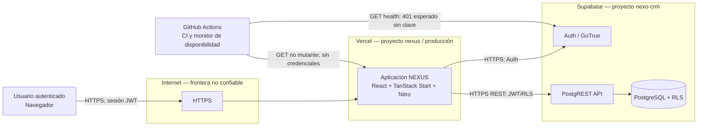

# 21 — Seguridad, despliegue y operación (Módulo 7)

> **Estado: evaluación aprobada por el equipo el 29/10/2026.** Los controles existentes fueron comprobados contra el código el 23/10/2026. El equipo aprobó el modelado STRIDE, la aceptación temporal de riesgos, el plan mínimo de observabilidad, la decisión de despliegue y ADR-008.
>
> Este módulo cubre las semanas 13-14, que hasta hoy no tenían ningún entregable en el dossier.

## El hallazgo que ordena todo el módulo

El sistema tiene **controles preventivos sólidos y verificables**, y prácticamente **ninguna capacidad de detección**.

La prueba no es teórica: cuando el proyecto de Supabase fue eliminado en septiembre, **el equipo no se enteró por una alerta sino porque una persona lo avisó**. El mismo patrón se repitió en octubre con el build de Vercel, que estuvo roto una semana sin que nadie lo notara, bloqueado por un CVE.

Dos incidentes reales, ninguno detectado por el sistema. Ese es el eje honesto del Módulo 7.

---

## 1. Activos y flujos críticos

Inventario verificable, base para el modelado de amenazas.

| Activo | Dónde vive | Exposición |
|---|---|---|
| Datos del CRM | 14 tablas en PostgreSQL | API REST pública de Supabase, protegida por RLS |
| Identidad y sesiones | Supabase Auth (GoTrue) | Endpoint público de autenticación |
| Clave `service_role` | Variable de entorno, solo servidor | Bypassa RLS por completo |
| Claves publicables | Bundle del navegador | Públicas por diseño |
| Esquema y políticas | `supabase/migrations/` | Versionado en Git |
| Credenciales de despliegue | Vercel y Supabase | Cuentas administradas por integrantes |

**Flujos críticos:** autenticación → sesión → consulta con RLS → render; y el flujo administrativo que usa `service_role` sin RLS.

## 2. Controles que ya existen y están verificados

Esto es lo que hay **hoy en el código**, con su punto de aplicación y cómo se comprueba.

| Control | Dónde aplica | Verificación |
|---|---|---|
| **RLS** en toda la base | 40 políticas sobre 14 tablas | `rls-isolation.integration.test.ts` — corre en cada PR |
| **Frontera del cliente privilegiado** | `service_role` solo en `*.server.ts` | `service-role-boundary.test.ts` — probada rompiéndola adrede |
| **Aislamiento de secretos por bundler** | Vite solo inyecta variables con prefijo `VITE_`; la clave se lee sin ese prefijo | Verificado el 23/10/2026 |
| **Protección de importación** | `importProtection` en `vite.config.ts`, con `behavior: "error"` | Falla el build |
| **Propiedad de datos por módulo** | Toda consulta respeta al propietario y sus JOINs | `persistence-fitness.test.ts`. Secuencia verde → rojo → verde conservada en [`26-demostracion-fitness-function.md`](26-demostracion-fitness-function.md) |
| **Ausencia de ciclos entre módulos** | ArchUnitTS | `persistence-fitness.test.ts` — incluye un ciclo deliberado |
| **Timeout de lectura** | 3.000 ms por request a Supabase | `supabase-fetch.ts` |
| **Circuit breaker** | Abre tras **3 fallos**, enfría **1.000 ms** | `read-circuit-breaker.test.ts` |
| **Captura de errores fuera de banda** | Recupera el stack que h3 descarta en un 500 genérico | `error-capture.ts` |
| **Traza de auditoría del cambio de etapa** | Trigger `deals_stage_history` → tabla `deal_stage_history`, con `changed_by` hacia `profiles` y RLS activa | Migración inicial; verificado el 23/10/2026 |
| **Puerta de integración** | Ningún merge sin `unit-tests` ni `rls-integration-test` | Branch protection, probada en vivo bloqueando un merge |

> **Cuatro de estos controles se probaron rompiéndolos a propósito.** Es la diferencia entre un control declarado y uno verificado, y conviene decirlo en la defensa.

### Superficie realmente alcanzable

Hallazgo de la auditoría del 23/10/2026, que acota la superficie de ataque mejor que cualquier declaración: de las **14 tablas**, solo **8 tienen dueño declarado** en `src/architecture/persistence-rules.ts`. Como la fitness function trata cualquier `.from()` fuera de `src/modules/*/api.ts` como violación, las otras seis —`deal_stage_history`, `tags`, `taggables`, `stakeholders`, `stakeholder_relationships` y `client_documents`— **no se pueden consultar desde el código sin romper el CI**, y de hecho ninguna se consulta.

La lectura correcta tiene dos caras y conviene dar las dos:

- **A favor:** reduce la superficie de ataque de la aplicación a 8 tablas. Las otras seis quedan protegidas por RLS *y* por una barrera estática.
- **En contra:** `stakeholders` se agregó como entregable en la semana 3 y hoy es **esquema sin consumidor**. No es un riesgo de seguridad, pero sí una inconsistencia entre lo entregado y lo usado.

## 3. Lo que NO existe — brecha de detección

| Capacidad | Estado |
|---|---|
| Métricas de aplicación | **Parcial desde el 06/11/2026.** `read-observability.ts` registra latencia, estado y fallo de cada lectura. Sin métricas de negocio ni panel |
| Logs estructurados con correlación | **Parcial.** Las señales salen como JSON por `console.warn`; **sin identificador de correlación** entre peticiones |
| Trazas | **No existe** |
| Alertas | **No existe.** Hay señales emitidas; **nadie las recibe**: falta el monitor sintético y un destino |
| SLO definidos | **No existe** |
| Runbooks | **Uno**, [`RB-001`](runbooks/RB-001-perdida-del-proyecto-supabase.md), para la pérdida del proyecto. Los demás no existen |
| Auditoría de acciones de usuario | **Parcial.** Solo el cambio de etapa queda registrado. Desde el 06/11 `readDealStageHistory` permite consultarlo, pero **ninguna pantalla lo muestra todavía** |
| Monitoreo de disponibilidad del proveedor | **No existe** — el incidente de septiembre lo demuestra |

**Consecuencia directa y comprobada:** los dos incidentes reales del proyecto se detectaron por aviso humano, no por el sistema.

## 4. Matriz STRIDE

El equipo identificó, priorizó y aceptó temporalmente los riesgos residuales siguientes. Cada aceptación conserva una acción de mitigación concreta.

> **La matriz desarrollada vive en [`24-matriz-stride.md`](24-matriz-stride.md)**, con la superficie y los controles verificados desglosados por categoría. La tabla de abajo es el resumen; esa es la hoja de trabajo.

> **Advertencia de método de la propia lámina:** *"la existencia de autenticación no cierra por sí sola todas las categorías de amenaza"*. Conviene no marcar una categoría como cubierta solo porque hay login.

| Categoría STRIDE | Amenaza concreta sobre un activo | Prioridad | Control que aplica | Dónde se verifica | Riesgo residual |
|---|---|---|---|---|---|
| **S** — Suplantación | Una cuenta comprometida podría iniciar sesión como usuario porque MFA está habilitada, pero no es obligatoria. | Alta | Supabase Auth, JWT, MFA TOTP disponible y confirmación doble en cambios sensibles | `use-auth.ts`; `supabase/config.toml` | Medio, aceptado temporalmente mientras se exige MFA en cuentas administrativas |
| **T** — Manipulación | Un uso indebido del flujo con `service_role` podría modificar datos ignorando RLS. | Alta | RLS, RPC de borrado lógico, reglas de persistencia y prueba de aislamiento | Migraciones; `persistence-fitness.test.ts`; `rls-isolation.integration.test.ts` | Medio, aceptado mientras `service_role` siga limitado a servidor y protegido por fitness function |
| **R** — Repudio | Un usuario podría negar crear, editar o eliminar datos porque solo los cambios de etapa tienen traza atribuible. | Alta | Trigger append-only `deal_stage_history` para cambios de etapa | Migración inicial; tabla `deal_stage_history` | Alto, aceptado temporalmente; falta traza para crear, editar y eliminar |
| **I** — Divulgación | Una política RLS mal configurada podría permitir leer datos de otro usuario. | Alta | RLS, frontera de `service_role`, variables sin prefijo `VITE_` y CI | Migraciones; `service-role-boundary.test.ts`; CI | Medio, aceptado con auditoría progresiva de las 40 políticas RLS |
| **D** — Denegación | Una sobrecarga o límite del proveedor podría degradar la API. | Alta | Timeout de 3 s, circuit breaker y consultas por lotes | `supabase-fetch.ts`; `read-circuit-breaker.test.ts`; S11 | Alto, aceptado temporalmente mientras se implementa monitoreo y alerta |
| **E** — Elevación | Un fallo en el uso de `service_role` o una función privilegiada podría otorgar acceso administrativo indebido. | Alta | Frontera de `service_role`, `SECURITY DEFINER` con `search_path` fijo y roles en tabla propia | `service-role-boundary.test.ts`; migraciones | Bajo-Medio, aceptado mientras CI bloquee violaciones y se controle el acceso administrativo |

**Pistas de dónde hay evidencia real para apoyarse, sin que esto sustituya el análisis:**

- *Repudio* es la categoría más descubierta, pero **no está vacía, como afirmaba la primera versión de este documento**. El trigger `deals_stage_history` registra quién movió qué oportunidad, de qué etapa a cuál y cuándo. Lo que falta es alcance y uso: cubre **solo** el cambio de etapa, la aplicación **nunca la lee**, y el resto de las acciones no deja rastro. Exponer esa traza es probablemente la mitigación más barata de todo el módulo, porque el dato ya se está escribiendo.
- *Elevación* tiene el control más fuerte y verificado: la frontera de `service_role`, con tres capas.
- *Denegación* tiene controles parciales medidos: timeout de 3 s y circuit breaker, pero **no se midió** el comportamiento del sistema bajo ataque, solo bajo carga.
- *Divulgación* tiene RLS, pero el hueco declarado es que **las 40 políticas nunca se auditaron una por una** (riesgo R4).

## 5. Riesgos operativos

> **Corte de validación: 06/11/2026, commit `3e05cf5`.** Los dueños son los
> roles acordados en el acta del mini-comité 2; la fecha es una revisión
> programada, no evidencia de que el riesgo se haya eliminado.

| Riesgo operativo | Prioridad | Riesgo residual y aceptación | Mitigación actual verificada | Dueño | Próxima revisión | Pendiente comprobable |
|---|---|---|---|---|---|---|
| Pérdida del proyecto del proveedor | Alta | Alto, aceptado temporalmente | Esquema versionado; restauración local probada en EXP-003 | Carlos Correa (Operaciones) | 13/11/2026 | Supabase muestra que el plan Free no incluye backups del proyecto. Falta respaldo externo y definir/medir RPO y RTO. |
| Dependencia de una sola cuenta administradora | Alta | Medio, aceptado temporalmente | El proyecto `nexo-crm` es accesible al equipo; la evidencia histórica confirma acceso compartido a Supabase | Felipe Piragauta (Seguridad) | 13/11/2026 | Verificar en cada cuenta administrativa de Supabase, Vercel y GitHub que MFA esté activada; confirmar rol mínimo y acceso de los tres a Vercel. |
| Vulnerabilidad en dependencia | Media | Medio, aceptado | CI y Vercel bloquean despliegues fallidos | Felipe Piragauta (Seguridad) | 20/11/2026 | Configurar/revisar una notificación de vulnerabilidades y conservar la evidencia de la revisión. |
| Caída silenciosa en producción | Alta | Alto, aceptado temporalmente | Monitor no mutante versionado en `.github/workflows/availability-monitor.yml`; señales de lectura en `read-observability.ts` | Carlos Correa (Operaciones) | 13/11/2026 | Confirmar un destinatario humano de los fallos de GitHub Actions y ejecutar el monitor desde `main`. |

## 6. Plan de observabilidad

Debe conectarse con los modos de fallo ya identificados en [`../docs/resilience_matrix.md`](../docs/resilience_matrix.md), que es trabajo del Módulo 6 y sirve de insumo directo.

| Qué observar | Señal | Umbral / SLO | Qué acción dispara |
|---|---|---|---|
| Disponibilidad del proveedor | Monitor sintético de la aplicación y verificación no mutante de Supabase | Alerta tras 2 fallos consecutivos en 10 minutos | Revisar Vercel/Supabase, registrar incidente y aplicar el runbook de recuperación si corresponde |
| Latencia de lectura | Duración registrada en el cliente de Supabase | Investigar lecturas mayores a 2.000 ms o timeout de 3.000 ms | Revisar consulta, RLS, proveedor y carga antes de optimizar |
| Tasa de error | Errores de servidor y respuestas fallidas registradas | Más de 2% en una ventana documentada de 15 minutos | Revisar logs, identificar ruta afectada y abrir incidente |
| Aperturas del circuit breaker | Transición del breaker a estado abierto | 3 aperturas en una hora | Revisar disponibilidad del proveedor; no reintentar en bucle ni ocultar el fallo |

> **Criterio de realidad:** el plan debe ser proporcional a un equipo de 3 personas con 6-8 horas semanales y plan gratuito. Proponer una pila de observabilidad de empresa sería el mismo error de sobreingeniería que el módulo 4 enseñó a evitar.

### Implementación mínima y límite de la alerta

El repositorio incorpora el workflow [`availability-monitor.yml`](../.github/workflows/availability-monitor.yml).
Cada diez minutos, y también bajo ejecución manual, realiza dos comprobaciones no mutantes
separadas por cinco minutos: `GET` a la URL pública de producción debe devolver `200` y
`GET` al health de Auth de Supabase debe devolver `401` sin clave (respuesta esperada que
demuestra que el servicio contestó sin exponer credenciales). El job queda rojo solo si el
mismo objetivo falla en ambas comprobaciones.

La señal queda en la ejecución y resumen de **GitHub Actions**; Carlos Correa es el dueño
operativo. Esto es un monitor activo versionado, pero **no equivale todavía a una alerta
recibida por una persona**: falta confirmar la suscripción/notificación de los responsables
una vez que el workflow esté en `main`. Vercel Free tampoco ofrece alertas personalizadas,
por lo que no se declara esa capacidad como existente.

## 7. Despliegue y alternativas

**Estado actual verificado (06/11/2026):** una unidad de despliegue en Vercel,
con Supabase gestionado. El dashboard de Vercel muestra producción **Ready** para
`main` en el commit `3e05cf5`; `https://nexus-green-xi.vercel.app` respondió HTTP
`200`. El dashboard de Supabase muestra el proyecto `nexo-crm`
(`xysncmauhogsvqtqeshe`) como **Healthy** y de tamaño Nano.

### Vista de despliegue C4 — nodos, flujos y fronteras

| Nodo / frontera | Flujo permitido y evidencia | Límite de confianza |
|---|---|---|
| Navegador → Vercel | HTTPS a la URL de producción; la aplicación gestiona la sesión en `src/hooks/use-auth.ts` | El navegador y toda entrada del usuario no son confiables. |
| Vercel → Supabase Auth / REST | HTTPS; `src/lib/supabase-fetch.ts` aplica timeout y circuit breaker a lecturas. | JWT y RLS son la frontera de datos. La `service_role` solo existe del lado servidor y su frontera tiene fitness function. |
| Supabase API → PostgreSQL | PostgREST ejecuta políticas RLS definidas en `supabase/migrations/`. | La base no debe confiar en que el cliente filtre datos; RLS decide por usuario. |
| GitHub Actions → endpoints públicos | Solo `GET`; no usa claves ni muta datos, definido en `.github/workflows/availability-monitor.yml`. | Es una sonda externa; no tiene acceso a la base, variables ni sesiones. |

### Costos operativos: mismo horizonte y supuestos

El horizonte de comparación es **12 meses**. Se conserva el supuesto aprobado por el
mini-comité: tres integrantes aportan en total 18–24 h por semana, no existe una tarifa
horaria `R` defendible y el costo se expresa en semanas de capacidad, no en dinero
inventado. Los precios y límites contratados son una incógnita explícita; Supabase confirma
plan Free/Nano y que no incluye backups administrados.

| Alternativa | Supuestos comparables | Esfuerzo/costo a 12 meses | Conclusión |
|---|---|---|---|
| Vercel + Supabase gestionados (actual) | Una unidad, proveedor administrado, 1–3 h/mes de operación y 8–16 h iniciales; sin infraestructura adicional | 26–64 h con coordinación = 1–4 semanas de capacidad | Mantener. Es la única alternativa desplegada y verificada. |
| Autoalojar app y Supabase con Docker | Incluye actualizaciones, backups, monitoreo y respuesta a incidentes; no existe medición propia ni cotización | **No cuantificado:** se descarta por riesgo operativo, no por una cifra fabricada | No adoptar mientras no haya presupuesto, responsable 24/7 y recuperación probada. |
| Separar servicios/despliegues por módulo | Dos contextos extraídos; contratos, credenciales, coordinación y operación adicional | 200–400 h con coordinación = 8–22 semanas de capacidad; infraestructura extra aún sin cotizar | No adoptar: no hay necesidad demostrada y el esfuerzo supera el horizonte del curso. |

La primera y tercera estimación son las mismas del acta y de
`experimentos/EXP-004-resiliencia/tco-supuestos.json`; la segunda se conserva sin número
para no presentar una estimación de IA como una factura o medición.

El equipo acepta la dependencia de Vercel y Supabase como trade-off. La mitigación aprobada es acceso administrativo compartido, MFA, migraciones versionadas, respaldo/restauración y observabilidad mínima.

## 8. ADR del módulo

El módulo pide un **ADR 5**. En la numeración del equipo corresponde el **ADR-008**, por la misma razón documentada en `adrs/README.md`: los números del curso y los del repositorio no coinciden, y existe una tabla de equivalencias.

El equipo registró esta decisión en [`ADR-008`](adrs/ADR-008-observabilidad-minima-y-operacion-compartida.md): mantener servicios gestionados y adoptar observabilidad mínima y operación compartida.
