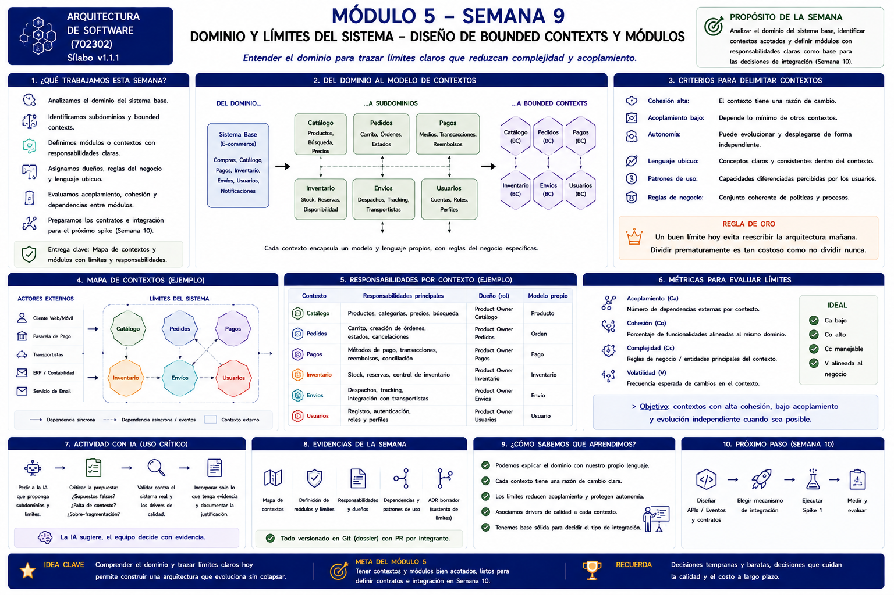
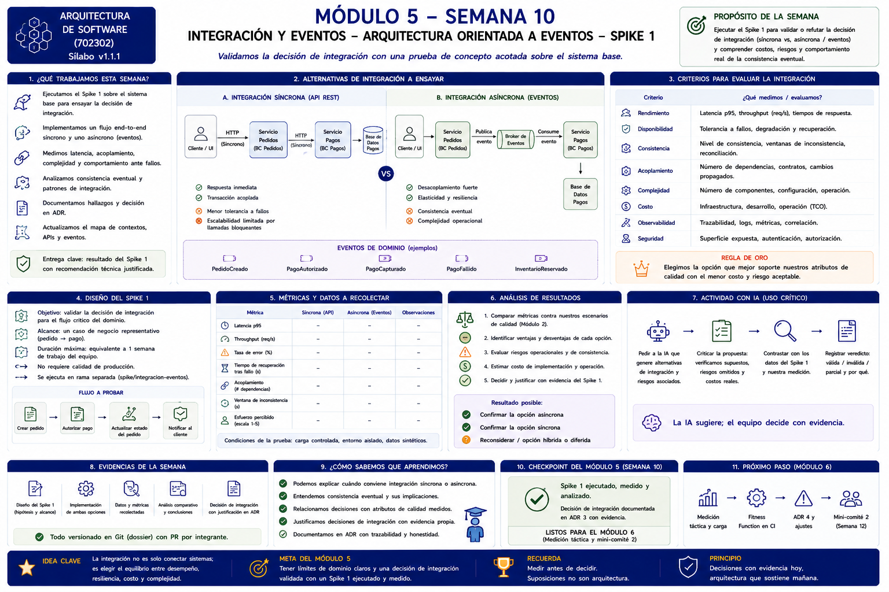
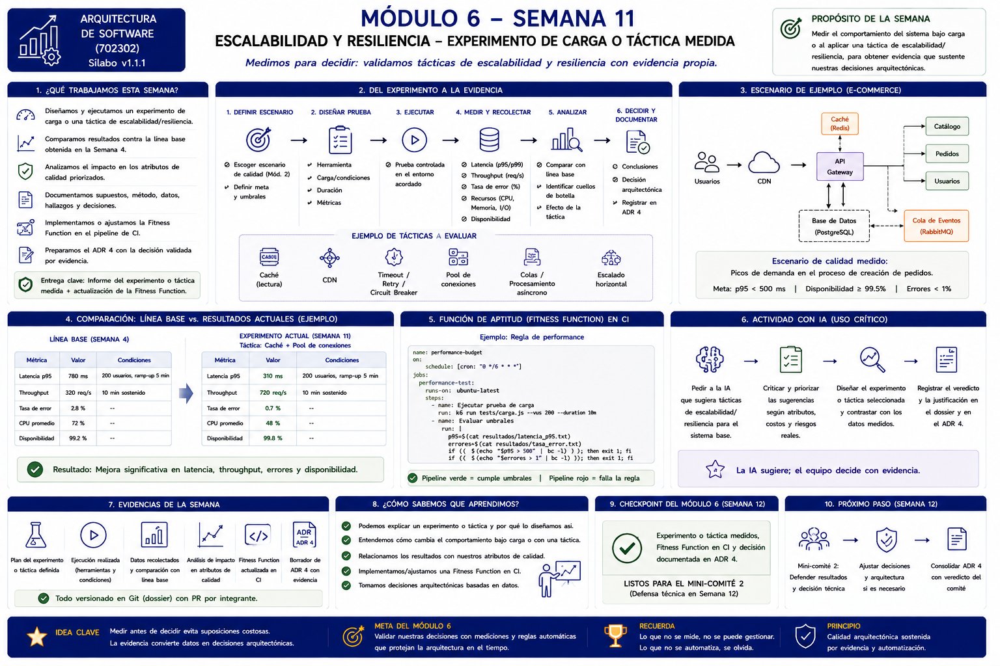
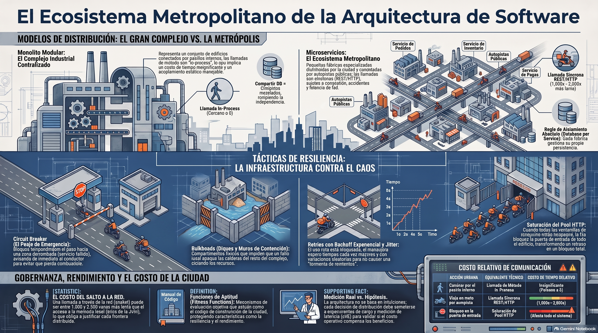
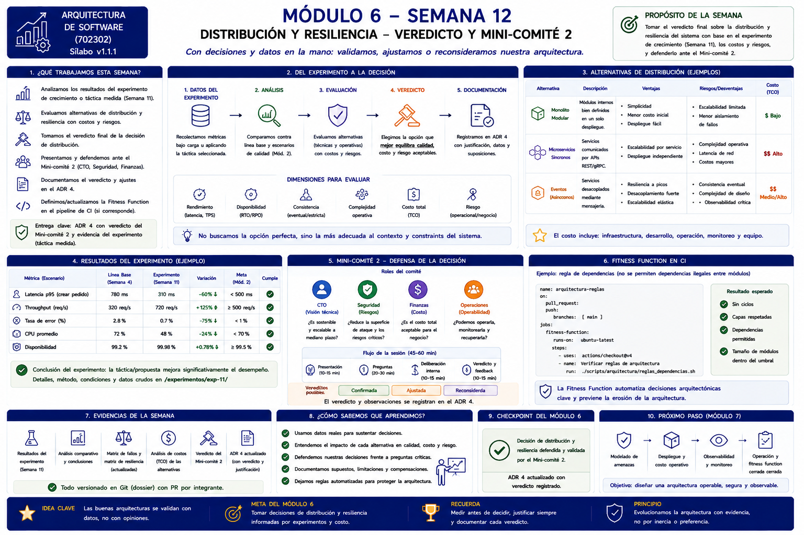
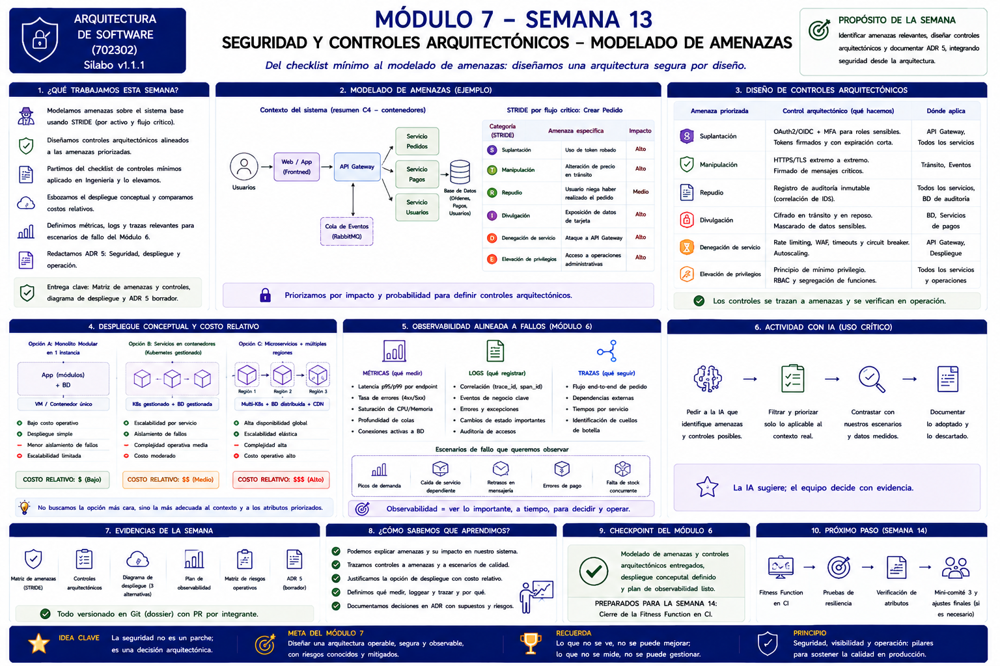
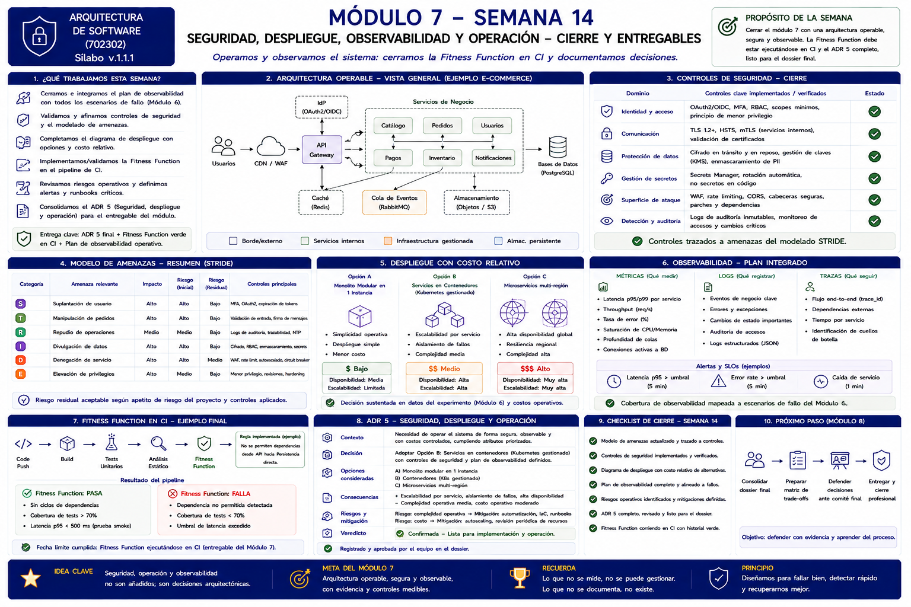
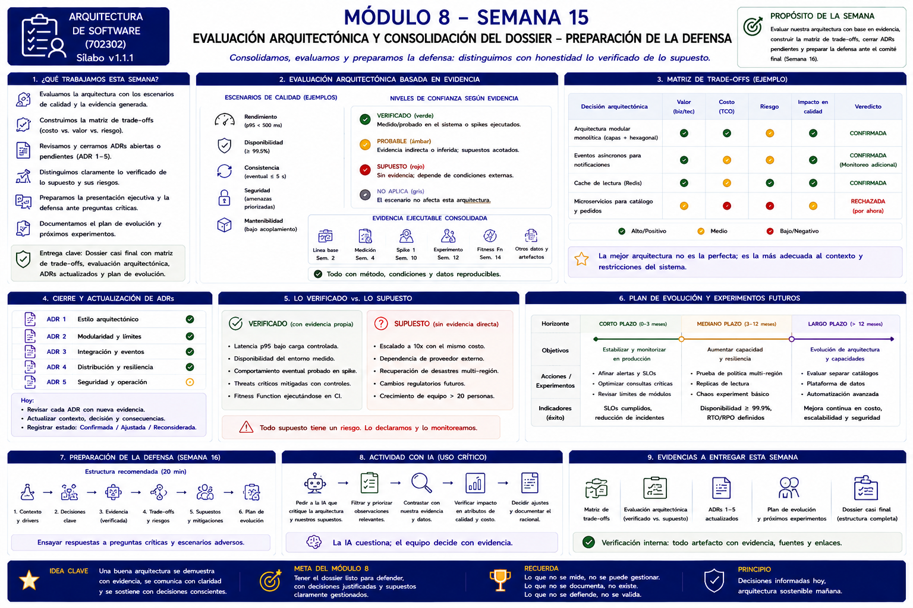
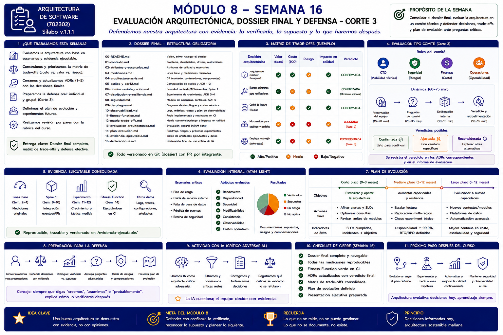

# Análisis de las imágenes de los módulos 5, 6, 7 y 8 de AVATA

Consulta: **16 de octubre de 2026, Colombia**.

Este es el análisis del alcance corregido: **módulos 5–8**, cuyas láminas tienen referencias internas a las semanas 9–16. Se inspeccionaron visualmente las **nueve imágenes originales** que aparecen en esas secciones del curso: dos del módulo 5, tres del módulo 6, dos del módulo 7 y dos del módulo 8. Las copias locales acompañan este informe.

La comparación con NEXUS utiliza `main`, commit `72622d1b1f247957a6496f6fa2a64e361486d276`, coincidente con el remoto al consultarlo. No se modificó el código, no se ejecutaron nuevos experimentos y no se enviaron entregas ni cambios a GitHub.

## Lectura del conjunto

Las imágenes describen una progresión acumulativa:

**M5: delimitar e integrar → M6: experimentar y decidir → M7: proteger y operar → M8: evaluar y defender.**

El eje común es conectar cada decisión con una necesidad del sistema, un experimento o control verificable, sus costos y riesgos, y un registro en Git. En todos los módulos se pide uso crítico de IA y participación mediante PR por integrante.

Las arquitecturas de comercio electrónico, Redis, RabbitMQ, Kubernetes, pasarelas de pago y despliegues multi-región son ejemplos de las láminas. No demuestran que esos elementos existan en NEXUS ni obligan a incorporarlos. Los números de latencia, throughput, disponibilidad y cobertura ilustran escenarios; no son resultados de este CRM.

## Módulo 5 — Dominio e integración

### Imagen 1: dominio, bounded contexts y módulos

La imagen transforma el sistema base en subdominios y después en contextos delimitados. El ejemplo usa catálogo, pedidos, pagos, inventario, envíos y usuarios; lo que debe trasladarse al proyecto es el procedimiento de delimitación.

El mapa debe explicar:

- qué responsabilidad tiene cada contexto;
- qué reglas y lenguaje propios contiene;
- quién es su dueño o responsable;
- qué datos/modelo le pertenecen;
- de qué otros contextos depende y con qué tipo de comunicación.

Los criterios son cohesión, acoplamiento, autonomía, lenguaje ubicuo, patrones de uso y reglas de negocio. La lámina propone observar dependencias, cohesión, complejidad y volatilidad. No fija un valor numérico de aprobación para esas métricas.

**Lectura arquitectónica:** tener pantallas o tablas separadas no demuestra que existan límites de dominio bien definidos. Tampoco exige convertir cada contexto en un microservicio: el propio conjunto compara alternativas monolíticas y distribuidas.

**Entregables visibles:** mapa de contextos, definición de módulos y límites, responsabilidades y dueños, dependencias, patrones de uso y ADR borrador que justifique los límites.

### Imagen 2: integración, eventos y Spike 1

Esta lámina es más exigente que simplemente describir cómo se integra el sistema: pide implementar un flujo extremo a extremo síncrono y uno asíncrono, medirlos y usarlos para contrastar la decisión.

El spike es acotado: un caso de negocio representativo, duración máxima indicada de una semana de trabajo del equipo, rama separada y sin requerir calidad de producción. Se registran hipótesis y alcance antes del resultado.

La comparación cubre latencia p95, throughput, errores, recuperación, acoplamiento, ventana de inconsistencia, esfuerzo, complejidad, costo, seguridad y observabilidad. Las tablas tienen casillas vacías: **son datos que debe producir el equipo**, no números para copiar.

El resultado puede confirmar integración síncrona, confirmar asincronía o reconsiderar una opción híbrida/diferida. La lámina vincula explícitamente la decisión con **ADR 3** y con evidencia del spike.

**En NEXUS:** se observan capacidades CRM en `src/lib/crm.ts`, rutas y componentes, con acceso a Supabase. Eso sirve como punto de partida para analizar el dominio. No se encontró en los documentos y experimentos versionados revisados un mapa de bounded contexts con responsables e interfaces, un contrato de integración explícito o el Spike 1 comparativo. El ADR-003 actual trata de RLS, no de integración respaldada por un spike.

**Balance:** hay un sistema integrado; falta demostrar el trabajo específico de dominio e integración que piden estas dos imágenes.

## Módulo 6 — Distribución, resiliencia, rendimiento y costo

### Imagen 3: experimento de carga o táctica medida

La secuencia visual es: definir escenario y umbral → diseñar prueba → ejecutar → medir → analizar → decidir y documentar.

La prueba debe contrastarse con la línea base bajo condiciones identificables. Las métricas incluyen latencia p95/p99, throughput, errores, recursos y disponibilidad. Las tácticas ilustradas incluyen caché, CDN, timeout/retry/circuit breaker, pool de conexiones, colas y escalado horizontal. La imagen no exige implementar todas.

El ejemplo muestra una mejora después de aplicar una táctica; **no permite afirmar que esa misma mejora ocurriría en NEXUS**. Un experimento sin mejora también puede producir información útil si se conserva el método y se ajusta la conclusión.

La evidencia esperada incluye plan, condiciones, ejecución, datos, comparación y análisis de impacto en atributos. Se vincula a una fitness function en CI y al borrador de **ADR 4**.

### Imagen 4: ecosistema metropolitano

La metáfora representa el monolito modular como edificios conectados internamente y los microservicios como fábricas comunicadas por carreteras públicas. Su enseñanza es que cruzar una frontera de red introduce latencia, fallos y costo operacional.

También representa:

- **Circuit breaker:** suspender temporalmente llamadas a una dependencia que falla.
- **Bulkheads:** aislar recursos para reducir propagación de fallos.
- **Backoff con jitter:** espaciar y dispersar reintentos para evitar sobrecarga coordinada.
- **Saturación del pool:** las esperas consumen capacidad y pueden bloquear el sistema.
- **Fitness functions:** controles repetibles de restricciones arquitectónicas.

La imagen contiene texto deformado y cifras generales de costo relativo de llamadas. Se retiene el principio cualitativo; **esas cifras no deben presentarse como medición del proyecto ni como una constante universal**.

### Imagen 5: veredicto y mini-comité 2

El experimento debe terminar en una decisión de distribución proporcional al contexto. Se comparan monolito modular, servicios síncronos y eventos según rendimiento, disponibilidad, consistencia, complejidad, TCO y riesgo.

El comité incorpora perspectivas técnicas, de seguridad, financieras y operativas. El veredicto —confirmada, ajustada o reconsiderada— se registra en ADR 4 junto con datos, supuestos y observaciones.

**Entregables visibles:** resultados, análisis comparativo, matrices de fallos y resiliencia, costos de alternativas, veredicto y ADR actualizado, más una regla arquitectónica ejecutada en CI.

**En NEXUS:**

- EXP-001 y EXP-002 conservan scripts, semilla, condiciones y resultados de API local. EXP-002 aumenta el volumen de datos, pero conserva cinco VUs; no demuestra por sí solo resistencia a un aumento de concurrencia.
- Los experimentos tienen mezclas de peticiones distintas. No se debe atribuir toda diferencia de p95 exclusivamente al volumen o a una táctica.
- El Log EDAV conserva una comparación del timeout: aproximadamente 2.145 ms sin el cambio y 2.135 ms con él. El propio documento concluye que la diferencia no es significativa. **Existe evidencia de evaluación; no de una mejora demostrada por ese timeout.**
- EXP-003 verifica restauración lógica local para un volumen acotado; no demuestra RPO/RTO, recuperación automática o multi-región.
- Existe una fitness function de frontera `service_role` y CI publicado. Es un control concreto de seguridad, no un presupuesto de rendimiento ni un validador completo de todas las dependencias.
- No se encontró un paquete consolidado de matrices de fallos/resiliencia, TCO comparativo y veredicto del mini-comité 2. El ADR-004 actual confirma arquitectura monolítica, pero no desarrolla todo el razonamiento experimental que muestran estas láminas.

**Balance:** módulo parcialmente sustentado; los experimentos existentes son útiles si se mantienen sus límites y se conectan a una decisión y evaluación completas.

## Módulo 7 — Seguridad, despliegue, observabilidad y operación

### Imagen 6: amenazas y controles arquitectónicos

La lámina pide modelar amenazas sobre activos y flujos críticos con STRIDE: suplantación, manipulación, repudio, divulgación, denegación de servicio y elevación de privilegios.

Cada amenaza se prioriza y se conecta con un control verificable y el punto donde aplica. La existencia de autenticación no cierra por sí sola todas las categorías de amenaza.

También se comparan opciones de despliegue con costo relativo y se diseña observabilidad conectada a los fallos del módulo 6. Se piden métricas, logs y trazas que expliquen qué observar y por qué.

**Entregables visibles:** matriz STRIDE, controles, diagrama de despliegue con alternativas, plan de observabilidad, matriz de riesgos operativos y borrador de **ADR 5**.

### Imagen 7: cierre operativo

El cierre exige integrar y verificar los controles, documentar riesgo residual, terminar el despliegue y el ADR 5, y tener la fitness function ejecutándose en CI.

La observabilidad debe cubrir los escenarios de fallo relevantes con métricas, logs estructurados, correlación, alertas y SLO. Además se mencionan runbooks críticos y mitigaciones operativas.

La arquitectura central de la imagen es un ejemplo e-commerce con gateway, WAF, Redis, RabbitMQ y S3. **No es un plano obligatorio para el CRM.** Lo obligatorio en el análisis es justificar la operación real y qué riesgos/controles corresponden al sistema del equipo.

La lista de seguridad menciona identidad, comunicación, datos, secretos, superficie de ataque y auditoría. Los checks verdes del ejemplo no certifican la implementación de NEXUS.

**En NEXUS:**

- Hay Supabase Auth, políticas RLS, prueba de aislamiento entre dos usuarios, protección del cliente privilegiado, timeout y manejo de errores.
- Hay documentación de incidente y recuperación; es evidencia aprovechable para riesgo operativo.
- No se encontró una matriz STRIDE completa, trazabilidad amenaza → control → verificación → riesgo residual, ni un paquete final de despliegue/observabilidad/alertas/runbooks con costo comparativo.
- No hay ADR 5 publicado en el árbol revisado.
- El dossier registra pendientes sobre MFA, privilegios y respaldo periódico. Son afirmaciones documentales de una revisión anterior, no comprobaciones nuevas del estado de la cuenta.

**Balance:** existen controles puntuales; el módulo requiere convertirlos en un diseño de seguridad y operación completo, trazable y verificable.

## Módulo 8 — Evaluación, dossier final y defensa

### Imagen 8: consolidación y preparación

La imagen exige evaluar con escenarios y evidencia acumulada. Distingue cuatro niveles de confianza: verificado, probable, supuesto y no aplica. Un índice de archivos ayuda a navegar, pero no convierte una hipótesis en resultado probado.

La matriz de trade-offs relaciona cada decisión con valor, TCO, riesgo, impacto en calidad y veredicto. Se revisan los cinco temas de ADR del curso: estilo, módulos/límites, integración, distribución/resiliencia y seguridad/operación.

La evolución debe proponer objetivos, experimentos e indicadores por horizonte. Un plan futuro es una propuesta que debe conservar su condición de tal.

### Imagen 9: estructura final y defensa

La lámina rotula como estructura obligatoria los siguientes **17 archivos**, del índice 00 al 16:

| Archivo de la lámina | Contenido |
|---|---|
| `00-README.md` | Visión y navegación. |
| `01-contexto.md` | Problema, stakeholders, drivers y restricciones. |
| `02-atributos-y-escenarios.md` | Atributos y escenarios de calidad. |
| `03-mediciones.md` | Línea base y mediciones. |
| `04-arquitectura-as-is.md` | C4 actual. |
| `05-estilos-y-adr12.md` | Comparación de estilos y ADR 1–2. |
| `06-dominio-e-integracion.md` | Contextos, contratos y Spike 1. |
| `07-distribucion-y-resiliencia.md` | Experimento, distribución/resiliencia y ADR 3–4 según el rótulo de esta lámina. |
| `08-seguridad.md` | Amenazas, controles y ADR 5. |
| `09-despliegue.md` | Despliegue y costos. |
| `10-observabilidad.md` | Métricas, logs, trazas y alertas. |
| `11-fitness-function.md` | Regla y resultados en CI. |
| `12-matriz-trade-offs.md` | Valor, costo, riesgo e impacto. |
| `13-evaluacion-arquitectonica.md` | Evaluación integral. |
| `14-plan-evolucion.md` | Roadmap, riesgos y próximos experimentos. |
| `15-evidencia-ejecutable.md` | Índice de artefactos, datos y resultados. |
| `16-declaracion-ia.md` | Uso crítico de IA. |

El dossier final también exige mediciones reproducibles, ADR con veredicto, fitness function en CI, revisión por pares y presentación ejecutiva. La defensa debe diferenciar lo verificado, lo supuesto y lo que se comprobará después.

El esquema del comité abarca CTO, seguridad, finanzas y operaciones. Sus gráficos de distribución de resultados y veredictos son ejemplos visuales, no evaluaciones ya realizadas sobre el proyecto.

**En NEXUS:** los documentos `12`, `13`, `14`, `15`, `16` y `17` organizan trade-offs, evaluación, evolución, evidencia, declaración de IA y defensa. `13` separa límites de evidencia y `14` distingue metas futuras: son avances relevantes. Sin embargo:

- `13` se declara inventario/propuesta para validación, no veredicto final;
- `14` es un roadmap propuesto;
- `16` en `main` conserva campos pendientes;
- el inventario de semana 15 mantiene tareas abiertas;
- los contenidos especializados de dominio, integración, resiliencia, seguridad, despliegue y observabilidad siguen incompletos o no se localizaron en la revisión;
- la numeración de los ADR actuales no coincide con los temas de las imágenes.

Tener los documentos finales no sustituye los experimentos y análisis que deben resumir. La prioridad es cerrar la evidencia de los módulos anteriores y después consolidar su evaluación.

## Comparación resumida con NEXUS

| Módulo | Lo que ya se puede aprovechar | Brecha principal |
|---|---|---|
| **5** | Sistema funcional, funcionalidades CRM y acceso real a Supabase. | Dominio delimitado, contratos e implementación/análisis del Spike 1. |
| **6** | k6 con resultados, crecimiento de datos, comparación honesta del timeout, restauración y fitness function. | Experimento/decisión consolidados, matrices de fallos/resiliencia, TCO y veredicto documentado. |
| **7** | Auth, RLS, prueba de aislamiento, control `service_role`, manejo de errores e incidente operativo. | STRIDE completo, controles trazados, despliegue con costo, observabilidad operativa y ADR 5. |
| **8** | Matriz, evaluación, roadmap, índice de evidencia y guía de defensa. | Cerrar estados pendientes, completar módulos 5–7 y alinear ADR/contenidos con la estructura de cierre. |

### Correspondencia de temas ADR

| Tema esperado en las imágenes | Documento actual en `dossier/adrs/` con ese número |
|---|---|
| ADR 1: estilo | ADR-001: estilo en capas. Hay correspondencia temática, con detalles pendientes de comparación. |
| ADR 2: modularidad/límites | ADR-002: Supabase para autenticación/persistencia. **Tema diferente.** Hay un borrador de aislamiento en `docs/adr/0002`. |
| ADR 3: integración y eventos | ADR-003: RLS. **Tema diferente.** |
| ADR 4: distribución y resiliencia | ADR-004: monolito. Cubre parte de la elección de distribución, pero falta la evaluación completa basada en experimento y comité. |
| ADR 5: seguridad y operación | No localizado en el árbol publicado revisado. |

No corresponde inventar ADR ni veredictos para completar una numeración. Se deben identificar decisiones reales, registrar deliberación actual con fecha real y explicar el mapeo entre documentos existentes y los temas del curso.

## Qué completar primero

1. Delimitar el dominio y elegir un flujo real del CRM para el Spike 1; especificar hipótesis, contratos y criterios antes de medir.
2. Preparar la comparación de integración que solicita la imagen del módulo 5 y documentar el resultado, incluso si descarta la asincronía.
3. Relacionar la evidencia de rendimiento/resiliencia con una decisión del módulo 6, completar costos y matrices y registrar su revisión real.
4. Construir el paquete del módulo 7: amenazas, controles, despliegue, observabilidad, riesgos y decisión de operación.
5. Consolidar el módulo 8 con referencias reproducibles, estados de confianza, ADR alineados y declaración de IA completa.

## Fuentes y límites

- [Curso en AVATA](https://aulasvirtuales.utadeo.edu.co/course/view.php?id=86003).
- [Módulo 5](https://aulasvirtuales.utadeo.edu.co/course/section.php?id=1051205), [módulo 6](https://aulasvirtuales.utadeo.edu.co/course/section.php?id=1051206), [módulo 7](https://aulasvirtuales.utadeo.edu.co/course/section.php?id=1051207), [módulo 8](https://aulasvirtuales.utadeo.edu.co/course/section.php?id=1051208).
- Las nueve imágenes fueron obtenidas del inventario de recursos de la página abierta y revisadas a resolución original; no se dedujo su contenido a partir del texto alternativo.
- Los originales de las láminas están alojados en el directorio público `arq-sw-imagenes` del repositorio `nelsonss/nelsonss`, enlazado por AVATA.
- NEXUS: archivos publicados de `dossier/`, `docs/adr/`, `src/`, `.github/workflows/ci.yml` e historial del commit indicado.

**Este informe analiza las imágenes de los módulos 5–8 y su relación con el repositorio. No afirma una revisión exhaustiva de todos los recursos enlazados dentro de esas secciones ni una comprobación nueva del sistema desplegado.**
