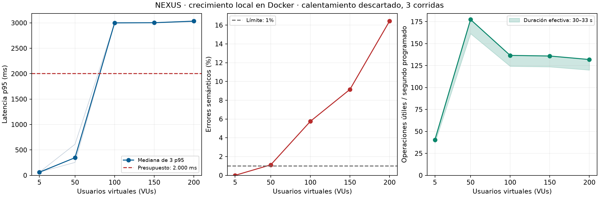

# Crecimiento S11 — NEXUS

[Prerregistro](../../docs/apuesta-crecimiento-S11.md) `e2dc488`, anterior al
código/instrumentación `0c4ca72` y a las mediciones. Docker local exclusivamente.

```sh
npm ci
npm run docker:growth
node experimentos/crecimiento-S11/summarize.mjs
python -m pip install matplotlib
python experimentos/crecimiento-S11/plot.py
```

Requiere Docker, Node y Python solo para las gráficas. El runner prepara Supabase
aislado `nexus-growth-tests`, 20 empresas/800 contactos/1.000 oportunidades,
verifica RLS de dos vendedores y ejecuta la imagen oficial `grafana/k6:2.3.0`.
La corrida `warmup` se descarta; `run-1`, `run-2`, `run-3` se conservan.
Las credenciales permanecen en memoria/entorno de contenedores, fuera de Git.
En Linux, k6 usa el UID/GID del usuario que prepara el directorio para poder
guardar los JSON del volumen montado; en Windows conserva el usuario de la imagen.
Al finalizar se eliminan únicamente los volúmenes del proyecto desechable.

Cada corrida contiene mesetas de 30 s a 5, 50, 100, 150 y 200 VUs, pausa 5 s y
graceful stop de hasta 3 s. Think time 100 ms, timeout HTTP 3 s; mezcla objetivo
80% consultas calientes (200 filas) /20% pipeline (1.000), por iteraciones de
cada VU. Cada VU inicia con una consulta completa, por lo que la mezcla efectiva
puede diferir ligeramente en corridas cortas. Un HTTP 200 con cuerpo incorrecto
cuenta como error. No hay proxy de fallos, circuit breaker ni retry en esta prueba.

Para otra duración: `GROWTH_SECONDS=120 npm run docker:growth` (en PowerShell,
configurar `$env:GROWTH_SECONDS='120'` antes). CI usa 3 s y se etiqueta **humo**:
no reemplaza las tres corridas locales de 30 s.

## Resultado conservado: 17/10/2026

Fuente [JSON, recursos y gráficas](resultados/local-2026-10-17/summary.json).
Se midió la ruta REST/DB sobre `0c4ca72`; el posterior refactor de módulos no
cambió tablas, políticas RLS ni la consulta HTTP de este experimento. Se añadieron
posteriormente tres funciones de borrado lógico; la carga de lectura no las invoca.

| VUs | Mediana de p95 (ms) | Mediana de p99 (ms) | Errores | Útiles / segundo programado |
| --: | ------------------: | ------------------: | ------: | --------------------------: |
|   5 |                  61 |                  82 |      0% |                       40,53 |
|  50 |                 347 |            2.998,16 |  1,119% |                      177,43 |
| 100 |               3.000 |            3.046,06 |  5,750% |                      136,60 |
| 150 |               3.003 |            3.037,48 |  9,153% |                      135,90 |
| 200 |               3.034 |            3.475,52 | 16,431% |                      131,90 |

Las métricas son medianas de tres resúmenes, no percentiles de una mezcla de
escalones. El contador útil se divide por 30 s programados; las terminaciones
durante graceful stop pueden extender el intervalo a 33 s. Para la tasa efectiva,
el límite inferior conservador es `útiles/33`; la gráfica muestra ese rango.

**Primer incumplimiento observado: 50 VUs**, por errores ≥1% en dos de tres
corridas; una corrida a 50 no tuvo errores. A 100/150/200 incumplen las tres.
La apuesta de **150 VUs queda refutada** respecto del escalón. No se modifica
retrospectivamente el prerregistro para hacerlo coincidir.



## Diagnóstico que permite la evidencia

Docker tenía 16 CPUs y 7,62 GiB asignados. Se conservaron 180 muestras de los
cinco contenedores (incluido el calentamiento). Máximos observados de CPU:
generador 437,83%, PostgreSQL 1.498,14%, REST 834,81%, Kong 237,51%, Auth 95,08%.
Docker expresa 100% por núcleo; estos máximos no necesariamente coinciden y no
deben sumarse. PostgreSQL mostró presión alta de CPU, compatible con contención
de capacidad del laboratorio, sin probar agotamiento del pool.

El generador comparte host/CPU con el sistema y hubo herramientas de desarrollo
en el host durante las corridas. Su máximo equivale a 4,38 núcleos de 16, pero
eso por sí solo **no descarta** límites de planificación, red, parsing o del
generador. No se capturaron esperas del pool ni trazas por consulta. Por tanto:

- Hay degradación reproducida del **conjunto laboratorio + instrumento**.
- El umbral de capacidad exclusivo del sistema sigue **inconcluso**.
- No se demuestra que microservicios, otro pool o una caché resuelvan el problema.
- Próximo experimento: generador en host separado y métricas DB/REST de esperas,
  consultas y conexiones; mantener la misma semilla y repetir antes de ajustar.

El breaker de EXP-004 se evalúa por separado: contiene fallos persistentes y no
es una solución demostrada para esta saturación sana. El ADR se revisó a la luz
del incumplimiento; no se declara el CRM apto para 50 VUs bajo este presupuesto.

## Versiones y límites

`environment.json` conserva SHA, versión/digest de imagen, Docker, tiempos,
recursos y limpieza. Los JSON nativos preservan conteos y percentiles de k6.
El perfil corto no evalúa crecimiento de datos, fugas de memoria, horas de carga,
renderizado de interfaz ni capacidad del Supabase contratado.

Referencias técnicas: [mesetas constant-vus](https://grafana.com/docs/k6/latest/using-k6/scenarios/executors/constant-vus/)
y [métricas k6](https://grafana.com/docs/k6/latest/using-k6/metrics/).
